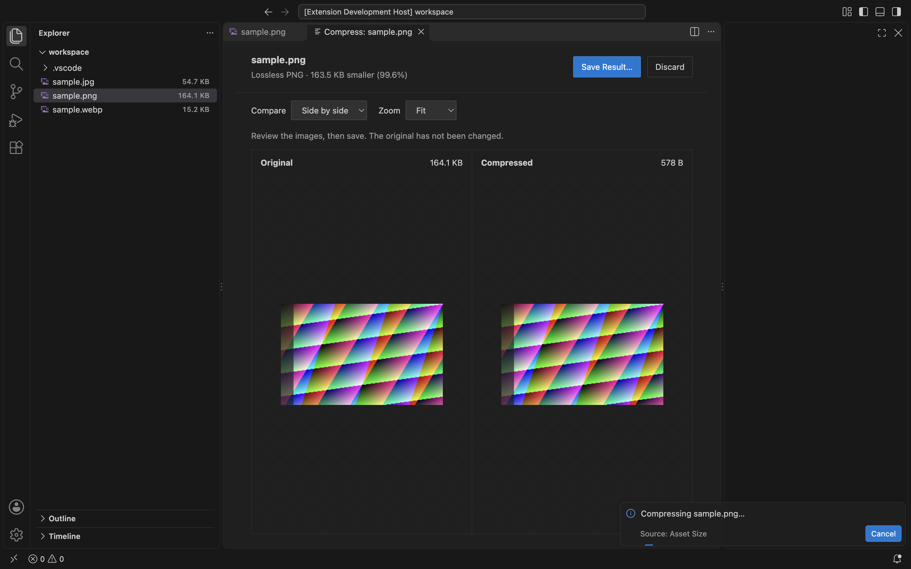

<p align="center">
  
</p>

<h1 align="center">Assets Size</h1>

<p align="center">Know what your assets weigh. Make your images lighter.</p>

<p align="center">
  <a href="https://github.com/zyyv/vscode-assets-size">GitHub</a> ·
  <a href="https://github.com/zyyv/vscode-assets-size/issues">Report an issue</a> ·
  <a href="https://github.com/zyyv/vscode-assets-size/blob/main/README.zh-CN.md">简体中文</a>
</p>

See file sizes and folder counts where you already work: VS Code's Explorer. Find heavy assets, then compress JPEG, PNG and WebP images locally with a visual comparison before saving.

**VS Code 1.90+ · Desktop extension · Local processing · MIT**

## At a glance

- **Sizes in Explorer.** Full file sizes and folder totals, with optional recursive or direct file counts.
- **Useful color cues.** Configurable warning, large and critical thresholds on size text; filenames keep their theme and Git colors.
- **Preview before saving.** Compare compressed images side by side or with a slider, at Fit or 100% zoom.
- **Your rules.** Choose include / exclude glob patterns, units and decimal precision. Saved changes refresh sizes automatically.
- **Private by design.** Bundled WebAssembly codecs; no uploads, telemetry or runtime network requests.

```text
▾ assets                         3 files · 7.9 MB
  ▾ images                       2 files · 7.9 MB
      hero.png                              6.3 MB
      texture.jpg                           1.6 MB
    logo.svg                                 39 B
```

> **Inline labels require an optional native Explorer patch.** VS Code's standard decoration API limits badges to two characters. The patch modifies three desktop program files, triggers VS Code's integrity warning and must be reapplied after editor updates. Hover tooltips and image compression work without it. Read [Native Explorer patch](#native-explorer-patch) before enabling inline labels.

## Quick start

1. Install the `.vsix` from this project's [GitHub Releases](https://github.com/zyyv/vscode-assets-size/releases), when available, using **Extensions → ⋯ → Install from VSIX…**. To build from source, see [Development](#development).
2. Open a workspace containing an `assets`, `public`, `static`, `images`, `img`, `media` or `fonts` folder. Hover over matching files and folders to see their sizes.
3. For full inline labels, run **Assets Size: Install / Reapply Native Explorer Patch** from the Command Palette, then choose **Reload Window**.

Run **Assets Size: Open Settings** to customize matching rules. An empty folder displays `0 files · 0 B`. Set `assetSize.include` to `["**/*"]` to decorate every file and folder.

## Compress images

Open a **JPEG, PNG or WebP** image in VS Code's built-in image preview and click **Compress Image** in the editor toolbar. You can also right-click an image in Explorer or run **Assets Size: Compress Image**.



*Screenshot from the 0.3.0 development build, before the Assets Size name update.*

1. Inspect the original and compressed sizes, savings, and image comparison. Switch between side by side and slider views, or inspect at 100% zoom.
2. Click **Save Result…**, then choose **Save As** or **Overwrite Original**, with **Allow Once** or **Always Allow**.
3. Choose **Discard** to close without saving. A successful save refreshes Explorer sizes.

**Save As** suggests `name.compressed.ext` and confirms before replacing an existing destination. **Overwrite Original** refuses to replace a source that changed after compression or has unsaved edits. **Always Allow** remembers the save action in User Settings; every compression still waits for **Save Result…**. Reset `assetSize.compression.saveBehavior` to `"ask"` to revoke that permission.

| Format | Codec | Behavior |
| --- | --- | --- |
| JPEG (`.jpg`, `.jpeg`, `.jpe`) | MozJPEG | Lossy; configurable quality |
| PNG | Oxipng | Lossless; quality setting does not apply |
| WebP | libwebp | Lossy; configurable quality |

Compression preserves the format and dimensions, applying JPEG orientation to the pixels. Metadata preservation is not guaranteed. Animated PNG/WebP, inputs larger than 50 MiB and images above 40 million pixels are rejected. If the result is not smaller, the original bytes are retained. Compression runs in a cancellable worker using locally bundled [jSquash codecs](https://github.com/jamsinclair/jSquash).

## Configuration

Open **Settings → Extensions → Assets Size**, or add this example to `.vscode/settings.json`:

```json
{
  "assetSize.displayMode": "always",
  "assetSize.include": ["**/*.{jpg,jpeg,png,svg,webp,woff2}", "**/{assets,public,images,fonts}"],
  "assetSize.exclude": ["**/.git/**", "**/node_modules/**", "**/.DS_Store"],
  "assetSize.showFileCount": true,
  "assetSize.fileCountMode": "recursive",
  "assetSize.units": "decimal",
  "assetSize.compression.quality": 75
}
```

Configured arrays **replace** the defaults. Matching uses [picomatch](https://github.com/micromatch/picomatch), relative to each workspace folder, with case-insensitive matching and dotfiles enabled. Matching paths does not read the filesystem. Exclusions are independent of `.gitignore` and `files.exclude`.

`assetSize.include` replaces the former `assetSize.fileExtensions` and `assetSize.folderNames` settings. Convert `[".png", ".tar.gz"]` to `["**/*.{png,tar.gz}"]` and `["assets", "images"]` to `["**/{assets,images}"]`. A directory pattern selects that directory itself; add `/**` to select its descendants as well. For example, `assets/**` selects `assets` and everything inside it.

| Setting | Default | Description |
| --- | --- | --- |
| `assetSize.enabled` | `true` | Enable size calculations and decorations. |
| `assetSize.displayMode` | `"always"` | Keep labels visible; `"hover"` shows counts and sizes on the right only while hovering that Explorer row. Both require the patch; tooltips work without it. |
| `assetSize.include` | Common asset formats and folders | Workspace-relative glob patterns for files and folders; supports `**`, `*`, braces, extglobs and negated patterns. `"**/*"` matches all resources; `[]` hides decorations. Does not limit folder totals. |
| `assetSize.exclude` | VCS, dependencies, `.DS_Store` | Workspace-relative glob patterns. Matching resources and their descendants are excluded from decorations and totals. |
| `assetSize.showFileCount` | `true` | Show the file count before folder size. |
| `assetSize.fileCountMode` | `"recursive"` | Count all descendants; `"direct"` counts immediate child files. Sizes always include descendants. |
| `assetSize.units` | `"decimal"` | Base 1000: KB / MB / GB. `"binary"` uses KiB / MiB / GiB. |
| `assetSize.decimalPlaces` | `1` | Size precision, from 0 to 3 decimal places. |
| `assetSize.colorize` | `true` | Color the trailing inline size by severity. |
| `assetSize.fileColorThresholdsMiB` | `[0.25, 1, 5]` | Yellow, orange and red file thresholds. Values are sorted. |
| `assetSize.folderColorThresholdsMiB` | `[10, 50, 100]` | Yellow, orange and red folder thresholds. Values are sorted. |
| `assetSize.refreshDelay` | `400` | Batch filesystem events for 100–5000 milliseconds. |
| `assetSize.compression.quality` | `75` | JPEG/WebP quality from 1 to 100. PNG is lossless. |
| `assetSize.compression.saveBehavior` | `"ask"` | `"ask"`, `"saveAs"` or `"overwrite"`. Only User Settings can grant remembered save permission. |

Default file pattern: `**/*.{jpg,jpeg,png,gif,webp,avif,svg,ico,bmp,heic,mp4,webm,mov,mp3,wav,ogg,woff,woff2,ttf,otf,pdf,zip}`.

Default folder pattern: `**/{assets,public,static,images,img,media,fonts}`. Matching a folder does not automatically decorate its subfolders.

Default exclusions: `**/.git/**`, `**/node_modules/**`, `**/.svn/**`, `**/.hg/**`, `**/.DS_Store`.

### Size colors

Thresholds use MiB (1,048,576 bytes), independently of display units. Defaults:

| Size text | Files | Folders |
| --- | --- | --- |
| Neutral | Below 256 KiB | Below 10 MiB |
| Yellow | At least 256 KiB | At least 10 MiB |
| Orange | At least 1 MiB | At least 50 MiB |
| Red | At least 5 MiB | At least 100 MiB |

Customize `assetSize.sizeWarning`, `assetSize.sizeLarge` and `assetSize.sizeCritical` in `workbench.colorCustomizations`. Set `assetSize.colorize` to `false` to use neutral size text.

## Commands

| Command Palette entry | Action |
| --- | --- |
| **Assets Size: Refresh Sizes** | Recalculate sizes and folder totals. |
| **Assets Size: Toggle Always / Hover** | Toggle always-visible labels and labels shown on row hover. |
| **Assets Size: Open Settings** | Open this extension's settings. |
| **Assets Size: Compress Image** | Compress an image and open its comparison. |
| **Assets Size: Install / Reapply Native Explorer Patch** | Install, upgrade or reapply the optional patch. |
| **Assets Size: Restore Native Explorer Patch** | Restore the original desktop program files. |

## Native Explorer patch

The patch expands the decoration badge limit for this extension and renders counts and sizes in the existing Explorer tree. Before changing three desktop program files, it creates backups and a SHA-256 manifest in `resources/app/.asset-size-native-patch`:

```text
out/vs/workbench/api/node/extensionHostProcess.js
out/vs/workbench/workbench.desktop.main.js
out/vs/workbench/workbench.desktop.main.css
```

Run **Assets Size: Install / Reapply Native Explorer Patch**, then reload. This requires write permission to the application directory. Integrity checks and code signatures are not disabled; VS Code may report that the installation appears corrupt. Tooltips and compression remain available without the patch. Reapply an older patch to enable inline labels on row hover.

Unsupported editor code layouts are rejected before writing. The minimum API version does not guarantee patch compatibility with every VS Code release or derivative. Reapply after editor updates. Upgrades from 0.2.0 / 0.2.1 reuse verified original backups without restoring first.

**Before uninstalling**, run **Assets Size: Restore Native Explorer Patch** and reload. Restoration checks program files and backups before writing, and refuses to overwrite files changed by an editor update or another tool. Original backups remain available. See [recovery commands](https://github.com/zyyv/vscode-assets-size/blob/main/docs/PUBLISHING.md#native-patch-recovery) if the extension is already uninstalled.

## Totals and compatibility

Folder totals include **all non-excluded descendant files**, regardless of the `include` patterns selecting decorations. Sizes reflect saved file bytes, not allocated disk blocks. Symbolic links are skipped. Unreadable items produce partial totals marked with `≥` and an explanation in the tooltip.

Results are calculated on demand, sharing cached file stats and subtree totals across requests, with up to 10,000 resource entries and 16 concurrent filesystem operations. After saves, additions, deletions and renames, workspace watchers update affected branches and cached ancestors before refreshing Explorer. Unchanged child contributions are reused; evicted branches are rebuilt when needed. Run **Assets Size: Refresh Sizes** if an external change is missed.

| Situation | What to check |
| --- | --- |
| Only tooltips appear | Reapply the patch, reload and enable `explorer.decorations.badges`. In `"hover"` mode, move the pointer over the Explorer row to reveal its label. |
| No size for an item | Check matching rules, exclusions, `assetSize.enabled` and symbolic links. |
| Remote SSH, WSL or Dev Containers | Calculations use the workspace extension host. Inline labels require access to local desktop program files; do not assume patch support in remote sessions. |
| Virtual workspace | Totals depend on the filesystem provider's stat, enumeration and watch support. |
| Browser / vscode.dev | Not supported; this extension requires a Node.js extension host and WebAssembly workers. |

## Privacy and licensing

No file uploads, telemetry or external network requests are made at runtime. In remote workspaces, processing happens on the workspace extension host. Codecs ship with the extension; image bytes are not sent to a service.

Assets Size is [MIT licensed](https://github.com/zyyv/vscode-assets-size/blob/main/LICENSE). See [third-party notices](https://github.com/zyyv/vscode-assets-size/blob/main/THIRD_PARTY_NOTICES.md) for bundled codec and dependency licenses.

## Development

Use Node.js 24+ and the pnpm version in `package.json`:

```sh
pnpm install --frozen-lockfile
pnpm lint
pnpm test
pnpm package
```

`pnpm test` builds the extension and runs the core, native patch and compression tests with Vitest. Use `pnpm test:unit` to run against an existing build, or `pnpm test:watch` to build once and watch the tests.

`pnpm package` typechecks and builds, then writes `artifacts/assets-size-<version>.vsix`. Install it from the Extensions menu. Press **F5** to launch the example workspace in an Extension Development Host.

For desktop integration and UI checks, use a disposable VS Code installation:

```sh
VSCODE_EXECUTABLE_PATH="/path/to/test/Code" pnpm test:integration
VSCODE_EXECUTABLE_PATH="/path/to/patched/test/Code" pnpm test:ui
VSCODE_EXECUTABLE_PATH="/path/to/test/Code" pnpm test:compression:ui
```

Without an executable path, integration tests download VS Code 1.90.2. UI checks use temporary profiles and workspaces; native patch checks must target a disposable application copy.

After the one-time `VSCE_PAT` setup in the [publishing guide](https://github.com/zyyv/vscode-assets-size/blob/main/docs/PUBLISHING.md), commit your changes and run `pnpm run publish`. Choose a version in bumpp; it updates the changelog, commits and pushes a `v*` tag. GitHub Actions checks, builds and publishes the extension to Marketplace, then creates a GitHub Release with the VSIX attached. Contributions and reproducible bug reports are welcome in [GitHub Issues](https://github.com/zyyv/vscode-assets-size/issues).
