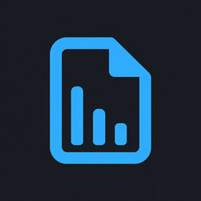

<p align="center">
  
</p>

<h1 align="center">Asset Meter</h1>

<p align="center">看清资源体积，让图片轻一点。</p>

<p align="center">
  <a href="https://github.com/zyyv/asset-meter">GitHub 仓库</a> ·
  <a href="https://github.com/zyyv/asset-meter/issues">问题反馈</a> ·
  <a href="https://github.com/zyyv/asset-meter/blob/main/README.md">English</a>
</p>

直接在 VS Code 资源管理器中查看文件大小和文件夹统计，找到占空间的资源。需要优化图片时，在编辑器里压缩 JPEG、PNG 和 WebP，对比效果后再保存。

**VS Code 1.90+ · 桌面扩展 · 插件式压缩 · MIT 开源**

## 主要功能

- **资源体积一目了然**：在原有 Explorer 文件树中显示完整大小、文件夹总大小和文件数量。
- **颜色提示大文件**：可配置黄色、橙色、红色阈值，只改变体积文字颜色，保留文件名主题和 Git 状态颜色。
- **先对比，再保存**：支持图片并排对比、滑块对比，以及适应窗口和 100% 缩放。
- **按项目定制**：自定义 include / exclude glob 规则、计量单位和精度；保存、创建、删除、重命名后自动刷新。
- **可选压缩插件**：默认使用本地 jSquash，也可配置 API Key 使用 TinyPNG 云端压缩；扩展不采集遥测。

```text
▾ assets                         3 files · 7.9 MB
  ▾ images                       2 files · 7.9 MB
      hero.png                              6.3 MB
      texture.jpg                           1.6 MB
    logo.svg                                 39 B
```

> **完整行内标签需要可选的原生 Explorer 补丁。** VS Code 标准装饰 API 的徽标最多支持两个字符。不安装补丁时，常驻模式显示短徽标（如 `2K`，为取整后的近似大小；无后缀表示字节），超出两字符时显示 `ⓘ`；悬停可查看精确大小。补丁会修改三个 VS Code 程序文件，可能触发 **“Your Code installation appears to be corrupt. Please reinstall.”** 完整性警告，并需要在编辑器更新后重新应用。启用前请阅读[完整性警告与恢复](#完整性警告与恢复)。

## 快速开始

1. 如果仓库已提供发布包，从 [GitHub Releases](https://github.com/zyyv/asset-meter/releases) 下载 `.vsix`，在 **扩展 → ⋯ → 从 VSIX 安装…** 中选择它。也可以按[本地开发](#本地开发)的说明自行打包。
2. 打开包含 `assets`、`public`、`static`、`images`、`img`、`media` 或 `fonts` 文件夹的工作区，悬停在匹配的文件或文件夹上查看体积。
3. 需要完整行内标签时，先阅读[完整性警告与恢复](#完整性警告与恢复)，再在命令面板执行 **Asset Meter: Install / Reapply Native Explorer Patch**，然后点击 **Reload Window**。这一步会修改 VS Code 程序文件。

运行 **Asset Meter: Open Settings** 修改匹配规则。空文件夹显示 `0 files · 0 B`。将 `assetMeter.include` 设置为 `["**/*"]`，即可显示所有文件和文件夹的装饰。

## 专属资源树

Explorer 中的 **Asset Meter** 面板按 `assetMeter.include` / `assetMeter.exclude` 显示命中的文件和目录，并保留通往命中项的父目录，隐藏无关分支。文件图标跟随当前文件图标主题，目录优先、名称自然排序；多工作区分别显示各自根目录。所有目录默认展开，可通过 **Collapse All** 或目录箭头手动收起。

名称右侧常驻显示完整体积，目录显示文件数和总大小；悬停可查看精确字节数。安装或更新原生 Explorer 补丁后，统计统一靠整行最右侧对齐，长文件名优先截断，大小文字按与原 Explorer 相同的阈值着色；文件名、文件数量和 metadata 标记保持原有颜色。未安装补丁时仍在文件名后面显示完整统计。面板统计不受 `displayMode` 影响。单位、精度、文件数量及 `colorize` 设置与原 Explorer 共用，目录总量仍统计所有未被 `exclude` 排除的文件，因此可能包含树中隐藏的文件。

资源右键菜单最底部的独立分组提供 **Delete**。点击后会弹出确认窗口，显示资源路径；删除目录时会说明包含其中的全部文件和子目录。支持时移入废纸篓，其他文件系统可能永久删除。取消后保留资源；面板不提供删除工作区根目录的操作。

在此面板悬停 JPEG、PNG、GIF、WebP、AVIF、SVG、ICO 或 BMP 时，上方显示图片预览，下方显示 **Path** 和 **Size**（含精确字节数）。预览支持本地及远程开发文件；其他文件和虚拟文件系统资源显示文字信息，目录仍保留文件数量和总大小。

检测到图片包含 metadata 时，Asset Meter 面板会在统计左侧显示 **`ⓘ`**。悬停可查看 EXIF、GPS、XMP、IPTC、ICC 或 PNG 文本等信息；在原 Explorer 或此面板右键选择 **Open Image Details**，会打开原生 Markdown 预览，上方为图片，下方为路径、体积和 metadata。悬停以居中的 `--------   MetaData   --------` 分隔基础信息，下面按相机与镜头、拍摄参数、时间与尺寸组织 key/value 行，Path、Size 和 metadata 统一使用普通 tooltip 字体和无边框双列布局，灰色 key 靠左、亮色 value 靠右并保留间距，多行 value 与 key 首行对齐；metadata 分组之间只留一个空行。每个 key 前保留灰色的内置 Codicons 图标和 4px 间距，key 与 value 使用统一行布局，共享首行文字基线，无需额外图标依赖或图片下载。日期、像素、焦距、颜色与 GPS 值自动格式化，省略未评级、默认方向、固件和重复时间。详情窗口使用同一份格式化结果，保留「字段 / 值」两列表格；没有有效数据时隐藏整个 Metadata 区域。EXIF 保留常用拍摄信息，过滤版本号、内部结构、校准数据和二进制块，重复字段只展示一次。不支持的格式仍可查看基本信息，图像能否显示取决于编辑器的格式支持。

Metadata 通过 `exifr` 在独立 Worker 中按需异步解析，不阻塞体积统计；悬停与 Markdown 预览共享最多 256 个资源的 LRU 缓存，并合并同一文件的并发请求。无 metadata 和解析失败的结果也会缓存，修改、删除、重命名或手动刷新后失效。Worker 串行处理任务，10 秒超时，空闲 15 秒释放；本地文件按段读取，远程或虚拟文件最大读取 32 MiB。PNG / WebP 的 metadata 段最多读取 8 MiB，PNG 解压后的数据也累计限制为 8 MiB，过大的字段会截断，悬停展示拍摄摘要和最多 4 个补充字段，完整预览使用同一份已缓存数据。

模块职责、扩展位置与性能约束见 [Metadata 模块说明](src/metadata/README.md)。

面板工具栏提供 **刷新、全部折叠、设置**。文件保存、创建、删除、重命名和规则变更会自动刷新。右键资源可在原 Explorer 中定位、诊断匹配规则；macOS 本地工作区还可选择 **Reveal in Finder**，打开所在目录并选中资源。JPEG / PNG / WebP 可直接进入现有压缩流程。没有匹配项时提供设置入口。

Asset Meter 面板的资源右键菜单提供独立的复制分组：**Copy Relative Path** 复制相对于该资源所属工作区目录的路径，**Copy Absolute Path** 复制完整文件路径；文件和目录均支持。JPEG、PNG、GIF、WebP、AVIF、SVG、ICO 和 BMP 还提供 **Copy Image**，将图片本身转为 PNG 复制，保留透明度，动图复制其中一帧，可直接粘贴到支持图片的应用。复制图片时会短暂打开复制标签页，写入剪贴板成功后自动关闭。复制成功后显示提示，失败时显示错误。文件打开遵循 VS Code 的单击或双击打开设置。

点击原生 Explorer 或 Asset Meter 面板中的 SVG，默认左侧打开可编辑源码、右侧显示图像预览。预览随未保存的代码修改实时更新，切换 SVG 时复用同一个预览窗格。设置中的 **Asset Meter: Svg Open Mode** 提供 **Both**（默认）、**Image**、**Code**：Image 仅显示预览，Code 仅显示源码。差异编辑器中的 SVG 不会触发预览。

## 图片压缩

在 VS Code 内置图片预览中打开 **JPEG、PNG 或 WebP**，点击编辑器右上角的 **Compress Image**。也可以在 Explorer 中右键图片，或运行 **Asset Meter: Compress Image**。

1. 在选择列表中选择压缩插件：**jSquash** 在本地运行，**TinyPNG** 将图片上传至其 API。对比页也可通过 **Plugin** 下拉框选择插件，再点击 **Compress Again** 重新压缩。
2. 查看原始体积、压缩后体积和节省比例；切换并排或滑块对比，必要时以 100% 缩放检查细节。
3. 点击 **Save Result…**，选择 **Save As** 或 **Overwrite Original**，再选择 **Allow Once** 或 **Always Allow**。
4. 点击 **Discard** 可关闭结果而不保存。保存成功后，Explorer 体积自动刷新。

**Save As** 默认建议 `name.compressed.ext`，目标文件已存在时会再次确认。**Overwrite Original** 会拒绝覆盖压缩后已变化或有未保存编辑的原文件。**Always Allow** 将保存方式记入用户设置，但每次压缩仍需点击 **Save Result…**。将 `assetMeter.compression.saveBehavior` 重设为 `"ask"` 可撤销记住的权限。

| 格式 | jSquash 编解码器 | 行为 |
| --- | --- | --- |
| JPEG（`.jpg`、`.jpeg`、`.jpe`） | MozJPEG | 有损压缩，支持质量设置 |
| PNG | Oxipng | 无损优化，不使用质量设置 |
| WebP | libwebp | 有损压缩，支持质量设置 |

压缩保留文件格式和图片尺寸；JPEG 方向会应用到像素。不保证保留元数据。不支持动画 PNG/WebP、超过 50 MiB 的输入或超过 4000 万像素的图片。如果结果没有变小，保存按钮会禁用。jSquash 在可取消的后台 worker 中运行，使用本地打包的[编解码器](https://github.com/jamsinclair/jSquash)。TinyPNG 支持同样的三种格式，自动选择压缩质量。

使用 TinyPNG 时，先[获取 API Key](https://tinypng.com/developers)，再在**用户设置**中填写 `assetMeter.compression.tinypng.apiKey`。Key 以明文存储，不参与 Settings Sync，也不会发送到对比页。每次压缩都会上传原始图片并使用 TinyPNG API 额度；仅切换下拉框不会发起请求。将 `assetMeter.compression.plugin` 设为 `"tinypng"`，即可在选择列表中优先显示它。请求遵循 [TinyPNG HTTP API](https://tinypng.com/developers/reference)。

API 调用失败会提示错误，原文件保持不变。**Compress Again** 失败时保留上一次成功的结果，并恢复操作按钮。可手动重试或切换插件，不会自动重试请求。原图和压缩结果都成功解码后才允许保存，无法解码的损坏结果不能通过对比页保存。

其他扩展可通过 `await vscode.extensions.getExtension('zyyv.asset-meter').activate()` 获取 API，调用 `api.registerCompressionPlugin(plugin)` 并将返回的 disposable 加入订阅。插件实现 `src/compression/plugins.ts` 中的 `CompressionPlugin` 接口：提供 ID、名称、说明、支持的格式、`describe(input)`，以及返回 `{ result: Promise<Uint8Array>, cancel() }` 的 `compress(input, context)`。选择列表和对比页会自动发现已注册插件；插件负责配置与编码，共用流程负责校验输入输出、对比和保存。

## 批量压缩、格式转换与画质

在 **Asset Meter** 面板中，用 **Cmd/Ctrl + 点击** 多选图片，或用 **Shift + 点击** 连续选择；右键选中的图片，选择 **Compress / Convert Images…**。Explorer 右键菜单也提供此命令，在命令面板运行则会打开多文件选择器。

1. 选择输出格式：**JPEG**、**PNG**、**WebP**，或 **Keep original format**（默认，保留原格式）。
2. 选择兼容的插件。**jSquash** 支持 JPEG、PNG、WebP 本地互转；PNG/WebP 保留透明度，JPEG 将透明区域合成到白色背景，JPEG 方向会应用到像素。保留格式时也可选择 TinyPNG。
3. 对支持手动画质的 JPEG/WebP 输出，输入 **1–100 的画质**，初始值取配置（默认 75）。PNG 使用无损编码；TinyPNG 等自动处理画质的插件不显示此输入框。
4. 在通知进度条中查看已完成/总数及成功、跳过、失败数量，可随时取消。完成通知中的 **Show Logs** 打开 Asset Meter 输出日志，记录批次 ID、文件路径、前后大小、耗时和错误。

结果保存在原图旁，使用所选格式的扩展名，例如 `name.compressed.jpg`、`name.compressed.png` 或 `name.compressed.webp`；重名时自动使用 `name.compressed-2.webp` 等编号，保留已有文件和原图。批量命令直接保存副本，不为每张图片打开对比页。同格式压缩未变小时跳过；明确转换格式时，即使体积增加也会保存。单张失败不会中断其他图片。取消会停止排队任务和正在编码的任务，已保存的副本保留。

单图预览和批量任务共用先进先出的任务池，默认同时处理 **2 张**（最多 4 张，并尽可能预留一个 CPU）。本地编码在独立 worker 中运行，每个任务槽涵盖读取、编码和保存，排队图片不会预先加载到内存。大任务默认每 **50 张**分一批。通过 `assetMeter.compression.concurrency` 设置并发数（1–4，修改后重新加载窗口），通过 `assetMeter.compression.batchSize` 设置每批数量（1–200）。输入大小、像素数和动画限制沿用单图规则。

压缩插件可选声明 `outputFormats` 并读取 `input.outputFormat` 来支持转换；自动处理画质的插件可声明 `quality: "automatic"`；未声明的插件仍只保留源格式。所有输出都会按请求格式校验。

## 配置

打开 **设置 → 扩展 → Asset Meter**，或将以下示例放入 `.vscode/settings.json`：

```json
{
  "assetMeter.displayMode": "always",
  "assetMeter.svgOpenMode": "both",
  "assetMeter.include": ["**/*.{jpg,jpeg,png,svg,webp,woff2}", "**/{assets,public,images,fonts}"],
  "assetMeter.exclude": ["**/.git/**", "**/node_modules/**", "**/.DS_Store"],
  "assetMeter.showFileCount": true,
  "assetMeter.fileCountMode": "recursive",
  "assetMeter.units": "decimal",
  "assetMeter.compression.plugin": "jsquash",
  "assetMeter.compression.quality": 75
}
```

自定义数组会**替换默认数组**。匹配使用 [picomatch](https://github.com/micromatch/picomatch)，相对于各工作区根目录，不区分大小写，包含点文件。路径匹配不读取文件系统。排除规则与 `.gitignore`、`files.exclude` 相互独立。

`assetMeter.include` 使用 glob 模式。例如，`["**/*.{png,tar.gz}"]` 匹配文件格式，`["**/{assets,images}"]` 匹配目录名。目录模式只选择目录本身；加上 `/**` 可同时选择其后代，例如 `assets/**` 选择 `assets` 及其全部内容。

| 设置 | 默认值 | 说明 |
| --- | --- | --- |
| `assetMeter.enabled` | `true` | 启用体积计算和装饰。 |
| `assetMeter.svgOpenMode` | `"both"` | **Both**：源码与实时图像预览并排显示；**Image**（`"image"`）：仅预览；**Code**（`"code"`）：仅源码。适用于原生 Explorer 和 Asset Meter 面板。 |
| `assetMeter.displayMode` | `"always"` | 常驻显示右侧标签；未安装补丁时显示短徽标或 `ⓘ`。`"hover"` 仅在鼠标移到该行时显示完整数量和大小，需补丁；未安装时仍可查看悬停提示。 |
| `assetMeter.include` | 常见资源格式和目录 | 选择文件和文件夹的工作区相对 glob，支持 `**`、`*`、花括号、extglob 和否定模式；`"**/*"` 匹配全部资源，`[]` 关闭装饰。不限制目录总量。 |
| `assetMeter.exclude` | 版本控制、依赖、`.DS_Store` | 工作区相对 glob；匹配资源及其后代不会显示装饰，也不计入总量。 |
| `assetMeter.showFileCount` | `true` | 在文件夹大小之前显示文件数量。 |
| `assetMeter.fileCountMode` | `"recursive"` | 统计所有后代文件；`"direct"` 只统计直接子文件。大小始终递归计算。 |
| `assetMeter.units` | `"decimal"` | 1000 进制 KB / MB / GB；`"binary"` 使用 1024 进制 KiB / MiB / GiB。 |
| `assetMeter.decimalPlaces` | `1` | 小数精度，范围为 0–3 位。 |
| `assetMeter.colorize` | `true` | 按体积级别为行内大小文字着色。 |
| `assetMeter.fileColorThresholdsMiB` | `[0.25, 1, 5]` | 文件的黄色、橙色、红色阈值，自动升序排序。 |
| `assetMeter.folderColorThresholdsMiB` | `[10, 50, 100]` | 文件夹的黄色、橙色、红色阈值，自动升序排序。 |
| `assetMeter.refreshDelay` | `400` | 文件系统事件批量刷新的延迟，范围为 100–5000 毫秒。 |
| `assetMeter.compression.plugin` | `"jsquash"` | 在选择列表中优先显示的插件：`jsquash`、`tinypng` 或其他已注册插件 ID。 |
| `assetMeter.compression.tinypng.apiKey` | `""` | 仅在用户设置中配置 TinyPNG API Key；明文存储，不参与 Settings Sync。 |
| `assetMeter.compression.quality` | `75` | jSquash JPEG/WebP 质量，范围为 1–100；jSquash PNG 无损，TinyPNG 忽略此设置。 |
| `assetMeter.compression.saveBehavior` | `"ask"` | `"ask"`、`"saveAs"` 或 `"overwrite"`；仅用户设置可授予记住的保存权限。 |

默认文件模式：`**/*.{jpg,jpeg,png,gif,webp,avif,svg,ico,bmp,heic,mp4,webm,mov,mp3,wav,ogg,woff,woff2,ttf,otf,pdf,zip}`。

默认目录模式：`**/{assets,public,static,images,img,media,fonts}`。匹配某个文件夹不会自动装饰它的所有子文件夹。

默认排除：`**/.git/**`、`**/node_modules/**`、`**/.svn/**`、`**/.hg/**`、`**/.DS_Store`。

### 体积颜色

阈值以 MiB（1,048,576 字节）计算，与显示单位独立。默认规则如下：

| 大小文字 | 文件 | 文件夹 |
| --- | --- | --- |
| 中性 | 小于 256 KiB | 小于 10 MiB |
| 黄色 | 至少 256 KiB | 至少 10 MiB |
| 橙色 | 至少 1 MiB | 至少 50 MiB |
| 红色 | 至少 5 MiB | 至少 100 MiB |

在 `workbench.colorCustomizations` 中修改 `assetMeter.sizeWarning`、`assetMeter.sizeLarge` 和 `assetMeter.sizeCritical`。将 `assetMeter.colorize` 设为 `false` 可使用中性大小文字。

## 命令

| 命令面板名称 | 作用 |
| --- | --- |
| **Asset Meter: Refresh Sizes** | 重新计算文件大小和文件夹总量。 |
| **Asset Meter: Toggle Always / Hover** | 切换右侧标签的常驻显示和悬停显示。 |
| **Asset Meter: Open Settings** | 打开本扩展的设置。 |
| **Asset Meter: Show Logs** | 打开 Output 面板中的 Asset Meter 日志。 |
| **Asset Meter: Diagnose File Matching** | 诊断当前文件或右键选择的资源，输出匹配原因、有效配置、大小和补丁状态。 |
| **Asset Meter: Compress Image** | 压缩所选图片并打开对比。 |
| **Asset Meter: Install / Reapply Native Explorer Patch** | 安装、升级或重新应用可选补丁。 |
| **Asset Meter: Restore Native Explorer Patch** | 恢复桌面程序原始文件。 |

## 日志与匹配诊断

运行 **Asset Meter: Show Logs**，或在 **查看 → 输出** 中选择 **Asset Meter**。默认记录启动版本、工作区、有效匹配配置、补丁状态、手动刷新以及文件系统错误。不会记录文件内容或 TinyPNG API Key。

某个文件没有显示时，在 Explorer 中右键它，选择 **Diagnose File Matching**。也可以在命令面板执行此命令，诊断当前文本编辑器中的文件；没有活动文本文件时会让你选择文件或目录。日志会说明是否在工作区、是否被禁用或排除、是否匹配 include、是否为符号链接，并在可计算时输出字节数和文件数量。未装补丁、等待重载或关闭 `explorer.decorations.badges` 也会明确记录。

需要查看逐文件自动处理过程时，运行 **Developer: Set Log Level...**，选择 **Asset Meter → Debug**，再运行 **Asset Meter: Refresh Sizes**。Debug 日志包含匹配结果、测量结果、刷新路径和最终徽标；正常使用时恢复 Info，避免大量逐文件日志。

## 原生 Explorer 补丁

补丁为本扩展的标签扩展徽标长度限制，并在现有 Explorer 文件树中渲染数量和体积。在修改程序前，会将原始文件及 SHA-256 清单备份到 `resources/app/.asset-meter-native-patch`。涉及以下三个文件：

```text
out/vs/workbench/api/node/extensionHostProcess.js
out/vs/workbench/workbench.desktop.main.js
out/vs/workbench/workbench.desktop.main.css
```

执行 **Asset Meter: Install / Reapply Native Explorer Patch** 后重载窗口，需要拥有桌面应用程序目录的写入权限。补丁不会禁用完整性校验或代码签名检查。不安装补丁也可以使用悬停提示和图片压缩。

写入前会校验编辑器代码结构；不支持的结构会被拒绝。最低 API 版本不代表补丁兼容每个 VS Code 版本或衍生编辑器。编辑器更新后需要重新应用。

### 完整性警告与恢复

> [!WARNING]
> **安装原生补丁后，VS Code 可能显示完整性警告：**
>
> `Your Code installation appears to be corrupt. Please reinstall.`
>
> 补丁修改上述三个程序文件，使其校验值与官方记录不一致，因此可能触发该警告，并将安装标记为 **Unsupported**。参见 [VS Code 官方说明](https://code.visualstudio.com/docs/supporting/faq#_installation-appears-to-be-corrupt-unsupported)。
>
> **解决方式：撤回补丁，恢复原始程序文件。**
>
> 1. 在命令面板执行 **Asset Meter: Restore Native Explorer Patch**。
> 2. 点击 **Reload Window** 重载窗口。
>
> **恢复后，依赖补丁的完整行内大小和文件数量显示会停止工作**；悬停提示和图片压缩仍可使用。如果恢复被拒绝或重载后仍出现警告，请按上述官方说明重新安装 VS Code。
>
> **卸载扩展前应先恢复补丁；单独卸载扩展不会恢复程序文件。**

恢复前会验证程序文件和备份，拒绝覆盖已被编辑器更新或其他工具改动的文件。恢复后仍保留原始备份。如果扩展已被卸载，请使用[恢复命令](https://github.com/zyyv/asset-meter/blob/main/docs/PUBLISHING.md#native-patch-recovery)。

## 统计规则与兼容性

文件夹总量包含**所有未被排除的后代文件**，不受选择装饰的 `include` 模式限制。大小是已保存的文件字节数，不是磁盘分配空间。符号链接会被跳过；遇到无法读取的项目，部分总量会标记 `≥`，并在悬停提示中解释。

结果按需计算，不同请求共享文件信息与子树统计缓存，最多保留 10,000 个资源条目，最多并发 16 次文件系统操作。保存、新增、删除和重命名后，工作区监听器先更新受影响的分支及已缓存的祖先目录，再刷新 Explorer；未变化的子项统计会被复用，已淘汰的分支会在需要时重新计算。外部变更未被捕获时，可执行 **Asset Meter: Refresh Sizes**。

| 情况 | 检查方式 |
| --- | --- |
| 只有短徽标、`ⓘ` 或悬停提示，没有完整行内大小 | 安装或重新应用补丁并重载，启用 `explorer.decorations.badges`；`"hover"` 模式需要将鼠标移到对应文件或目录行。 |
| 某项没有显示 | 右键该项运行 **Diagnose File Matching**，在 **Output → Asset Meter** 查看原因。 |
| Remote SSH、WSL、Dev Containers | 统计在工作区扩展宿主运行；完整行内标签需要访问本地桌面程序文件，不能假定远程会话支持补丁。 |
| 虚拟工作区 | 统计取决于文件系统提供者是否支持文件属性、目录枚举和变更监听。 |
| 浏览器或 vscode.dev | 不支持；扩展需要 Node.js 扩展宿主及 WebAssembly worker。 |

## 隐私与许可

扩展不采集遥测。jSquash 在本地处理图片，不上传文件、不发起外部网络请求。选择 TinyPNG 会使用你的 API Key，通过 HTTPS 将所选图片上传到 `api.tinify.com`。其他已注册插件可能使用不同服务，请查看对应说明。远程工作区中的处理及 API 请求发生在对应工作区的扩展宿主。

Asset Meter 使用 [MIT 许可证](https://github.com/zyyv/asset-meter/blob/main/LICENSE)。

## Credits

Asset Meter 使用了以下项目和服务：

- [picomatch](https://github.com/micromatch/picomatch)：文件和目录的 glob 匹配。
- [jSquash](https://github.com/jamsinclair/jSquash)，源自 [Squoosh](https://github.com/GoogleChromeLabs/squoosh)：本地 WebAssembly 图片编解码器。
- [MozJPEG](https://github.com/mozilla/mozjpeg) 和 [libjpeg-turbo](https://github.com/libjpeg-turbo/libjpeg-turbo)：JPEG 编码与解码。
- [libwebp](https://chromium.googlesource.com/webm/libwebp/) 和 [Oxipng](https://github.com/oxipng/oxipng)：WebP 编解码和 PNG 无损优化。
- [TinyPNG](https://tinypng.com/developers)：可选的云端图片压缩服务。

This software is based in part on the work of the Independent JPEG Group.

随包分发的依赖保留各自许可证。VSIX 中的 `dist/codecs/LICENSE*` 和 `dist/licenses/LICENSE*` 包含完整的上游许可证与声明。

## 本地开发

使用 Node.js 24+ 及 `package.json` 中指定的 pnpm 版本：

```sh
pnpm install --frozen-lockfile
pnpm lint
pnpm test
pnpm package
```

`pnpm test` 会先构建扩展，再通过 Vitest 运行核心逻辑、原生补丁和图片压缩测试。已有构建产物时，用 `pnpm exec vitest run` 重新运行测试，或用 `pnpm exec vitest` 监听测试变化。自动修复 lint 问题用 `pnpm lint --fix`。

`pnpm package` 会通过 `vscode:prepublish` 钩子检查类型、构建，并在仓库根目录生成 `asset-meter-<version>.vsix`，可从扩展菜单安装。按 **F5** 会在扩展开发宿主中打开示例工作区。

桌面集成和 UI 检查使用独立的 VS Code 测试副本：

```sh
VSCODE_EXECUTABLE_PATH="/path/to/test/Code" pnpm test:integration
VSCODE_EXECUTABLE_PATH="/path/to/patched/test/Code" pnpm test:ui
VSCODE_EXECUTABLE_PATH="/path/to/test/Code" pnpm test:assets:ui
ASSET_METER_EXPECT_RIGHT_ALIGNED=1 VSCODE_EXECUTABLE_PATH="/path/to/patched/test/Code" pnpm test:assets:ui
VSCODE_EXECUTABLE_PATH="/path/to/test/Code" pnpm test:compression:ui
```

不指定可执行路径时，集成测试下载 VS Code 1.90.2。UI 检查使用临时配置和工作区；补丁检查必须使用可丢弃的应用副本。

按[发布指南](https://github.com/zyyv/asset-meter/blob/main/docs/PUBLISHING.md)配置发布者以及仓库密钥 `VSCE_TOKEN` 和 `OVSX_TOKEN` 后，提交代码并运行 `pnpm release`。在 bumpp 中选择版本，它会更新 `package.json`、提交并推送 `v*` tag。GitHub Actions 随后执行检查和打包，将同一份 VSIX 发布到 Visual Studio Marketplace 和 Open VSX，再创建附带自动生成的更新说明及 VSIX 的 GitHub Release。`CHANGELOG.md` 按需手动维护。欢迎通过 [GitHub Issues](https://github.com/zyyv/asset-meter/issues)提交可复现的问题和改进建议。
