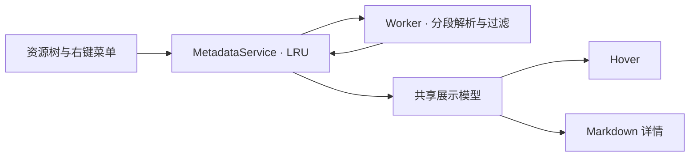

# 图片 Metadata 模块

解析、展示模型与渲染各自独立。资源树与详情窗口通过同一个 `MetadataService` 获取数据，统计文件体积不等待解析。

| 职责 | 入口 | 修改位置 |
| --- | --- | --- |
| 数据契约与过滤 | `types.ts`、`normalize.ts`、`formats.ts` | 支持格式、有效字段和输出裁剪；资源预算统一在 `limits.ts` |
| 异步解析 | `runner.ts` → `worker.ts` → `parser.ts` | `parsing/exifr.ts` 适配 exifr，`png.ts` / `webp.ts` 读取容器，`source.ts` 管理分段读取与解压预算 |
| 展示模型 | `presentation/index.ts` | `format.ts` 格式化值，`fields.ts` 定义标签、顺序、图标和分组，`summary.ts` 选择悬停摘要 |
| 视图渲染 | `rendering/markdown.ts` | `hover.ts` 负责原生 tooltip 布局，`text.ts` 集中转义、换行及 Markdown 单元格处理 |
| 缓存与预览 | `service.ts`、`preview.ts` | 并发请求合并、失效通知，以及只读 Markdown / 图片虚拟文件系统 |

**常见修改**

1. 增加展示字段：在 `presentation/fields.ts` 定义标签、图标和分组；需要合并原始字段时修改 `presentation/index.ts`。
2. 增加值的格式：修改 `presentation/format.ts`，详情与悬停会共用结果。
3. 增加容器格式：通过 `MetadataSource` 分段读取，最终只在 `parser.ts` 调用一次 `normalizeMetadata`。
4. 调整 tooltip：修改 `rendering/hover.ts`。原生 Markdown 会过滤 flex、gap 和垂直对齐 CSS；保留行内的首行基线结构，避免重新引入嵌套表格。
5. 资源右键操作：在上级 `resourceActions.ts` 注册；URI 父子关系由 `core/uri.ts` 统一判断。

**性能与行为约束**

- 一个复用 Worker 串行解析，10 秒超时，空闲 15 秒释放；输出与读取预算均在 `limits.ts`。
- LRU 最多保留 256 个资源，包括空结果和失败结果；同一文件的并发请求共用一个 Promise。
- 文件更改后按 URI 失效；远程读取结束和 Worker 完成时再次检查任务身份，失效任务不会发布旧结果。
- PNG / WebP 元数据最多读取 8 MiB；PNG 解压结果也累计受 8 MiB 约束。远程资源在 stat 和读取后分别检查 32 MiB 上限。
- 展示模型和悬停 HTML 使用 WeakMap 缓存；不改变原始解析数据，不把用户字段名当成图标、HTML 或命令。

验证使用 `pnpm test`。`scripts/check-asset-tree-view.mjs` 覆盖实际 VS Code 界面，文字基线与图标绘制区域的测量集中在 `scripts/ui/hover-layout.mjs`。
